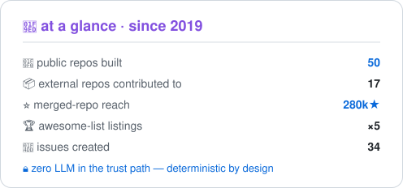

<!-- privacy: handle-only — no real name, no location, no employer anywhere in this file -->
<!-- 中文版:README.zh-CN.md -->

  

  <strong>building deterministic agent tooling — and fixing real bugs in the open source you actually run</strong> 
  工具链造在确定性上,名字写在合并记录里 —— 每一条都能点开验证

  
  
  

  
  

> 🧭 building deterministic agent tooling · fixing real bugs in 210k+★ of open source

### 🧰 Projects

50 repos, one thesis: the guard-rail must be deterministic — zero LLM in the trust path. Highlights:

**Personal projects**

| Repo | What it is |
|---|---|
| [gloss](https://github.com/zhengqiuyang/gloss) | Learn a term once, own it forever — a vocabulary notebook with an LLM for a heart · 查一次,永久拥有. Local-first, any OpenAI-compatible API |
| [harness-visualizer](https://github.com/zhengqiuyang/harness-visualizer) | Auto-visualize your agent's harness (outer system) as an interactive diagram · 把 agent 外围系统从配置自动可视化成结构图 |
| [lexiflow](https://github.com/zhengqiuyang/lexiflow) | 本地优先的全能英语学习应用:沉浸阅读 + SM-2 + 词书 + AI 口语(BYO key),零构建零依赖 |
| [git-dojo](https://github.com/zhengqiuyang/git-dojo) | 面向新手的 Git 闯关学习平台:真实沙盒终端 + 分支图实时可视化 + 仓库感知 AI 助教 |
| [shuorenhua](https://github.com/zhengqiuyang/shuorenhua) | 说人话 · 职场黑话词典 — 把 OKR、MVP、「对齐颗粒度」翻译成人话 · 147 terms × 8 categories |
| [yearfilm](https://github.com/zhengqiuyang/yearfilm) | 把一年照片自动生成有章节、配乐、运镜的回忆电影 · 全本地 · CLIP 选片 |
| [interview-mate](https://github.com/zhengqiuyang/interview-mate) | 🎯 AI Agent 驱动的面试训练系统:智能体教练 / 模拟面试 / 间隔重复 / 岗位雷达,零依赖本地运行 |
| [PixelTrace](https://github.com/zhengqiuyang/PixelTrace) | Pure-frontend pixel-level image diff — 6 comparison views, PSNR/SSIM/ΔE metrics, folder batch compare, zero upload |

**dsh plugins** — 10 of them listed in [awesome-dsh-plugin](https://github.com/awesome-dsh-plugin/awesome-dsh-plugin) (24.5k★)

| Plugin | What it does |
|---|---|
| [dsh-read-guard](https://github.com/zhengqiuyang/dsh-read-guard) | Prompt-injection interception — scans what the agent READS before it enters model context; obfuscation-resistant |
| [dsh-pr-gate](https://github.com/zhengqiuyang/dsh-pr-gate) | Deterministic write gate — scope policy + residue scan at the moment of the write |
| [dsh-attest-chain](https://github.com/zhengqiuyang/dsh-attest-chain) | Signed chain-of-custody — hash-chained, ed25519-signed records of what the agent actually did |
| [dsh-mcp-test](https://github.com/zhengqiuyang/dsh-mcp-test) | Tool-surface snapshot & drift gate — every visible tool baselined; silent changes fail loud |
| [dsh-egress-gate](https://github.com/zhengqiuyang/dsh-egress-gate) | Deterministic network egress gate — web fetches checked against an allowlist before they run |
| [dsh-prompt-drift](https://github.com/zhengqiuyang/dsh-prompt-drift) | System-prompt surface drift gate — sections any plugin contributes are hashed and baselined |
| [dsh-janitor](https://github.com/zhengqiuyang/dsh-janitor) | Artifact lifecycle — scans session debris, returns a reviewable cleanup plan; the janitor is never an agent |
| [dsh-freeze](https://github.com/zhengqiuyang/dsh-freeze) | Hermetic composition lock — profile fingerprint; drifted compositions warn or fail (strict) |
| [dsh-compaction-guard](https://github.com/zhengqiuyang/dsh-compaction-guard) | Compaction integrity — what the agent was told to remember and silently forgot is reported loudly |
| [dsh-trust-panel](https://github.com/zhengqiuyang/dsh-trust-panel) | Plain-language trust dashboard — nine channels, one status light, zero jargon |

…plus 40+ more: mcp-test, agent-attest, agent-pr-gate, agentbench-local, cronagent, backlens, ctxlens, clipbrain, callkeeper, clauselens, agent-skills, dsh-guardian-pet, dsh-spend-audit — <a href="https://github.com/zhengqiuyang?tab=repositories">full list</a>

### 🏆 Merged into

| Repo | ★ | PRs | Shipped |
|---|:-:|:-:|---|
| [home-assistant/core](https://github.com/home-assistant/core) |  | [#190963](https://github.com/home-assistant/core/pull/190963) · [#191537](https://github.com/home-assistant/core/pull/191537) · [#189882](https://github.com/home-assistant/core/pull/189882) · [#189876](https://github.com/home-assistant/core/pull/189876) · [#189635](https://github.com/home-assistant/core/pull/189635) | **×5** — tplink_omada sensor crash fixes, WeatherFlow stuck entities, PSK redaction in diagnostics, imou discovery matchers |
| [The-PR-Agent/pr-agent](https://github.com/The-PR-Agent/pr-agent) |  | [#4651](https://github.com/The-PR-Agent/pr-agent/pull/4651) · [#4652](https://github.com/The-PR-Agent/pr-agent/pull/4652) · [#4761](https://github.com/The-PR-Agent/pr-agent/pull/4761) · [#4787](https://github.com/The-PR-Agent/pr-agent/pull/4787) · [#4799](https://github.com/The-PR-Agent/pr-agent/pull/4799) | **×5** — diff-parsing robustness: unified-diff headers, fence-aware stripping, hunk mapping, per-provider line counts |
| [cline/cline](https://github.com/cline/cline) |  | [#15520](https://github.com/cline/cline/pull/15520) | streaming reasoning text cleared on session reset (VSCode) |
| [makecindy/cindy](https://github.com/makecindy/cindy) |  | [#8569](https://github.com/makecindy/cindy/pull/8569) | DeepSeek custom tool-cleaning applied across all model spellings |
| [opengeos/GeoLibre](https://github.com/opengeos/GeoLibre) |  | [#3301](https://github.com/opengeos/GeoLibre/pull/3301) | `readPluginAsset` app API for plugin-bundled assets |
| [wangzan101/Mika](https://github.com/wangzan101/Mika) |  | [#222](https://github.com/wangzan101/Mika/pull/222) | schedules re-computed in local time right after timezone change |
| [TestSprite/testsprite-cli](https://github.com/TestSprite/testsprite-cli) |  | [#723](https://github.com/TestSprite/testsprite-cli/pull/723) · [#724](https://github.com/TestSprite/testsprite-cli/pull/724) | **×2** — shared JUnit report-flag rules; same-name tests kept distinct |
| [opengeos/geoai](https://github.com/opengeos/geoai) |  | [#949](https://github.com/opengeos/geoai/pull/949) · [#950](https://github.com/opengeos/geoai/pull/950) | **×2** — honor `device`/`model` args; restore missing einops dependency |
| [reticlehq/reticle](https://github.com/reticlehq/reticle) |  | [#2147](https://github.com/reticlehq/reticle/pull/2147) | FOREIGN probe retried once; fill spelling mapped onto type |

every one of the 19 merged PRs is linked in the table above — click any number to verify

### 📊 Stats

<table align="center">
  <tr>
    <td width="50%">
      <picture>
        <source media="(prefers-color-scheme: dark)" srcset="assets/war-record-dark.svg" />
        
      </picture>
    </td>
    <td width="50%">
      <picture>
        <source media="(prefers-color-scheme: dark)" srcset="https://streak-stats.demolab.com?user=zhengqiuyang&hide_border=true&background=0D1117&border=30363D&dates=8B949E&ring=8B5CF6&currStreakNum=FFFFFF&currStreakLabel=22D3EE&sideNums=C9D1D9&sideLabels=8B949E" />
        
      </picture>
    </td>
  </tr>
</table>

numbers collected 2026-11-14 via GitHub API — every claim verifiable through the links above

### 🐍 Contribution snake

<picture>
  <source media="(prefers-color-scheme: dark)" srcset="assets/github-snake-dark.svg" />
  
</picture>

generated by GitHub Action — refreshed daily and on every push

### 🧰 Toolbox

  

Python · TypeScript · JavaScript at the core — deterministic CLIs & agent guard-rails, React front-ends, a hand-rolled numpy autograd engine; everything local-first, zero upload by default

---

<!-- built with: capsule-render · readme-typing-svg · streak-stats · skillicons.dev · platane/snk · 自绘 at-a-glance SVG -->
