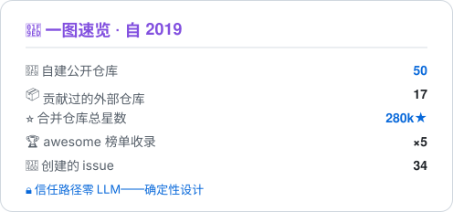

<!-- privacy: handle-only — 全文仅使用 handle,无真名/位置/雇主信息 -->
<!-- English version: README.md -->

  

  <strong><i>「Empty your mind, be formless, shapeless, like water.」</i></strong> 
  <strong>Be water, my friend.</strong> —— <i>李小龙</i>

  
  
  

  
  

🧭 用确定性给 agent 造护栏 · 修进 210k+★ 的开源项目

### 🧰 项目

50 个仓库,一个信念:护栏必须是确定性的——信任路径上零 LLM。精选:

**个人项目**

| 仓库 | 简介 |
|---|---|
| [gloss](https://github.com/zhengqiuyang/gloss) | 查一次,永久拥有 —— 以 LLM 为心的生词本,本地优先,兼容任意 OpenAI 接口 |
| [harness-visualizer](https://github.com/zhengqiuyang/harness-visualizer) | 把 agent 的外围系统(harness)从配置自动可视化成交互结构图 |
| [lexiflow](https://github.com/zhengqiuyang/lexiflow) | 本地优先的全能英语学习应用:沉浸阅读 + SM-2 + 词书 + AI 口语(BYO key),零构建零依赖 |
| [git-dojo](https://github.com/zhengqiuyang/git-dojo) | 面向新手的 Git 闯关学习平台:真实沙盒终端 + 分支图实时可视化 + 仓库感知 AI 助教 |
| [shuorenhua](https://github.com/zhengqiuyang/shuorenhua) | 说人话 · 职场黑话与术语词典:把 OKR、MVP、「对齐颗粒度」翻译成人话 · 147 词条 × 8 大类 |
| [yearfilm](https://github.com/zhengqiuyang/yearfilm) | 把一年照片自动生成有章节、配乐、运镜的回忆电影 · 全本地 · CLIP 选片 |
| [interview-mate](https://github.com/zhengqiuyang/interview-mate) | 🎯 AI Agent 驱动的面试训练系统:智能体教练 / 模拟面试 / 间隔重复 / 岗位雷达,零依赖本地运行 |
| [PixelTrace](https://github.com/zhengqiuyang/PixelTrace) | 纯前端像素级图像对比:6 种对比视图、变化区域聚类、PSNR/SSIM/ΔE 指标、文件夹批量对比,无后端无上传 |

**dsh 插件** —— 10 个被 [awesome-dsh-plugin](https://github.com/awesome-dsh-plugin/awesome-dsh-plugin)(24.5k★)收录

| 插件 | 简介 |
|---|---|
| [dsh-read-guard](https://github.com/zhengqiuyang/dsh-read-guard) | 提示注入拦截:在进入模型上下文之前扫描代理读了什么,抗混淆 |
| [dsh-pr-gate](https://github.com/zhengqiuyang/dsh-pr-gate) | 确定性写入门禁:写入瞬间的范围策略 + 残留扫描 |
| [dsh-attest-chain](https://github.com/zhengqiuyang/dsh-attest-chain) | 签名监管链:哈希链 + ed25519 签名,记录代理的真实行为 |
| [dsh-mcp-test](https://github.com/zhengqiuyang/dsh-mcp-test) | 工具面快照与漂移门禁:所有可见工具基线化,静默变更即大声报错 |
| [dsh-egress-gate](https://github.com/zhengqiuyang/dsh-egress-gate) | 确定性网络出口门禁:web 请求先过目的地白名单 |
| [dsh-prompt-drift](https://github.com/zhengqiuyang/dsh-prompt-drift) | 系统提示词漂移门禁:各插件贡献的段落哈希基线化 |
| [dsh-janitor](https://github.com/zhengqiuyang/dsh-janitor) | 产物生命周期:扫描会话残留,产出可审阅的清理计划——清洁工不是 agent |
| [dsh-freeze](https://github.com/zhengqiuyang/dsh-freeze) | 封闭组合锁:profile 指纹,组合漂移即警告或失败(strict) |
| [dsh-compaction-guard](https://github.com/zhengqiuyang/dsh-compaction-guard) | 压缩完整性:代理被告知记住却被悄悄忘记的内容,大声报告 |
| [dsh-trust-panel](https://github.com/zhengqiuyang/dsh-trust-panel) | 白话信任面板:九个通道,一个状态灯,零黑话 |

…另有 40+ 个仓库:mcp-test、agent-attest、agent-pr-gate、agentbench-local、cronagent、backlens、ctxlens、clipbrain、callkeeper、clauselens、agent-skills、dsh-guardian-pet、dsh-spend-audit —— <a href="https://github.com/zhengqiuyang?tab=repositories">完整列表</a>

### 🏆 合并记录

| 仓库 | ★ | PRs | 修了什么 |
|---|:-:|:-:|---|
| [home-assistant/core](https://github.com/home-assistant/core) |  | [#190963](https://github.com/home-assistant/core/pull/190963) · [#191537](https://github.com/home-assistant/core/pull/191537) · [#189882](https://github.com/home-assistant/core/pull/189882) · [#189876](https://github.com/home-assistant/core/pull/189876) · [#189635](https://github.com/home-assistant/core/pull/189635) | **×5** — tplink_omada 传感器崩溃修复、WeatherFlow 实体卡死、诊断信息 PSK 脱敏、imou 发现匹配器 |
| [The-PR-Agent/pr-agent](https://github.com/The-PR-Agent/pr-agent) |  | [#4651](https://github.com/The-PR-Agent/pr-agent/pull/4651) · [#4652](https://github.com/The-PR-Agent/pr-agent/pull/4652) · [#4761](https://github.com/The-PR-Agent/pr-agent/pull/4761) · [#4787](https://github.com/The-PR-Agent/pr-agent/pull/4787) · [#4799](https://github.com/The-PR-Agent/pr-agent/pull/4799) | **×5** — diff 解析健壮性:unified-diff 文件头、fence 感知剥离、hunk 映射、多 provider 行数统计 |
| [cline/cline](https://github.com/cline/cline) |  | [#15520](https://github.com/cline/cline/pull/15520) | 会话重置时清空流式 reasoning 文本(VSCode) |
| [makecindy/cindy](https://github.com/makecindy/cindy) |  | [#8569](https://github.com/makecindy/cindy/pull/8569) | DeepSeek 自定义工具清洗覆盖所有型号拼写 |
| [opengeos/GeoLibre](https://github.com/opengeos/GeoLibre) |  | [#3301](https://github.com/opengeos/GeoLibre/pull/3301) | 新增 `readPluginAsset` app API,供插件自带资源读取 |
| [wangzan101/Mika](https://github.com/wangzan101/Mika) |  | [#222](https://github.com/wangzan101/Mika/pull/222) | 改时区后立即按新时区重算按当地时间的计划 |
| [TestSprite/testsprite-cli](https://github.com/TestSprite/testsprite-cli) |  | [#723](https://github.com/TestSprite/testsprite-cli/pull/723) · [#724](https://github.com/TestSprite/testsprite-cli/pull/724) | **×2** — 统一 JUnit 报告参数规则;同名测试保持区分 |
| [opengeos/geoai](https://github.com/opengeos/geoai) |  | [#949](https://github.com/opengeos/geoai/pull/949) · [#950](https://github.com/opengeos/geoai/pull/950) | **×2** — 尊重 `device`/`model` 参数;补回缺失的 einops 依赖 |
| [reticlehq/reticle](https://github.com/reticlehq/reticle) |  | [#2147](https://github.com/reticlehq/reticle/pull/2147) | FOREIGN 探测失败重试一次;fill 拼写映射到正确类型 |

19 个合并 PR 全部带链接——点任意编号即可核验

### 📊 数据

<table align="center">
  <tr>
    <td width="50%">
      <picture>
        <source media="(prefers-color-scheme: dark)" srcset="assets/war-record-zh-dark.svg" />
        
      </picture>
    </td>
    <td width="50%">
      <picture>
        <source media="(prefers-color-scheme: dark)" srcset="https://streak-stats.demolab.com?user=zhengqiuyang&hide_border=true&background=0D1117&border=30363D&dates=8B949E&ring=8B5CF6&currStreakNum=FFFFFF&currStreakLabel=22D3EE&sideNums=C9D1D9&sideLabels=8B949E" />
        
      </picture>
    </td>
  </tr>
</table>

数字采集于 2026-11-14 GitHub API · 每一条都能点开上面的链接验证

### 🐍 贡献蛇

<picture>
  <source media="(prefers-color-scheme: dark)" srcset="assets/github-snake-dark.svg" />
  
</picture>

由 GitHub Action 生成 —— 每天与每次推送后自动刷新

### 🧰 工具箱

  

核心是 Python · TypeScript · JavaScript · C++17——确定性 CLI 与 agent 护栏、React 前端、手写 numpy autograd 引擎、PyTorch 跑 CLIP;一切本地优先,默认不上传

---

<!-- built with: capsule-render · readme-typing-svg · streak-stats · skillicons.dev · platane/snk · 自绘一图速览 SVG -->
